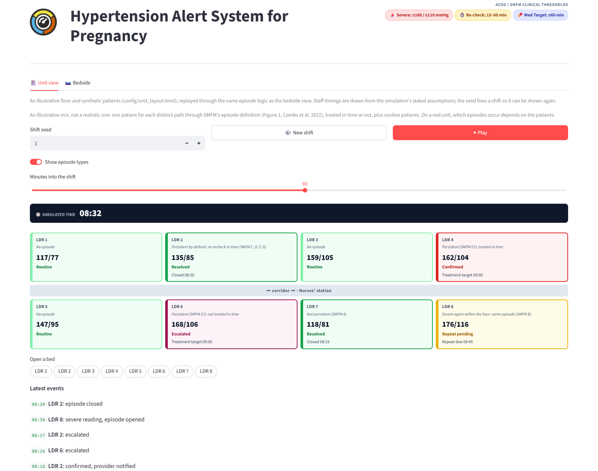

# Hypertension Alert System for Pregnancy

A prototype that helps labor and delivery staff treat severe high blood pressure
in time. It tracks each severe-range reading through rechecking, confirmation,
notifying a provider and treatment, so that no step depends on someone
remembering it.

Built for Hack-A-Roo 2026 at the University of Missouri–Kansas City, in the
Pitch-to-Build track, where a pitch team proposes a problem and a team of
builders makes a working prototype.

> **Research prototype. Not a medical device and not for clinical use.**
> All data in this repository is synthetic. No patient data is used or accepted.

- **Try the app:** <https://hypertension-alert-pregnancy-qrzuqnona3infydlandcuc.streamlit.app/>
  (if no one has used it for a while, it takes a minute to wake up)
- **Watch the demo video:** <https://youtu.be/QObCJRi1yW8>
- **Poster:** [PDF](docs/Hypertension%20Alert%20System%20for%20Pregnancy%20-%20Project%20Poster.pdf)

## The problem

Severe hypertension in pregnancy (systolic ≥ 160 or diastolic ≥ 110 mmHg) should
be treated within 60 minutes of the first severe reading. The Society for
Maternal-Fetal Medicine (SMFM) defines when a severe reading counts as
*persistent*, and so needs treatment: the blood pressure is severe again 15 to 60
minutes after the first reading, or no reading below the severe range is
documented within 15 minutes.¹

The pitch team, from the UMKC School of Medicine at the Mosaic Life Care campus
in St. Joseph, Missouri, found from chart audits that the biggest delays come at
two steps: rechecking the blood pressure on time, and finding the right provider
to notify.

¹ Combs CA et al. Society for Maternal-Fetal Medicine Special Statement: A quality
metric for evaluating timely treatment of severe hypertension. *Am J Obstet Gynecol*
2022;226(2):B2–B9. <https://doi.org/10.1016/j.ajog.2021.10.007>

## What it does

- **Rules, not AI, between a reading and an alert.** One episode tracker
  (`EpisodeTracker`, in `src/htn_alert/episodes.py`) applies SMFM's definition,
  with every threshold and time in `config/protocol.toml`, each with its source.
  It reports when a recheck is due, when an episode is confirmed and the provider
  notified, when it escalates, and when it closes. Escalation, our assumption, comes
  at whichever is first: 10 minutes without the provider's acknowledgment, or
  10 minutes before the treatment deadline. The app and the evaluation both run on
  this same tracker.
- **Unit view:** an illustrative eight-bed floor of synthetic patients, replayed
  through the tracker. It shows one patient for each way an episode can unfold
  under SMFM's definition, plus routine patients. Open any bed for its panel.
- **Bedside view:** enter readings by hand, record the provider's acknowledgment
  and a dose, and watch the countdowns.
- **EMR note draft:** a template writes the note's timeline from the episode's
  events, and a language model writes only a short summary at the top. Every time,
  number and identifier in the note must trace back to a recorded event or a
  protocol value; a summary that fails the check is dropped. The note is a draft
  for the nurse to review, and the prototype connects to no real health record.
- **Evaluation:** a paired simulation of 80 synthetic patients, without and with
  the tool. The tool's effect on how fast staff notice a reading, recheck it and
  reach a provider is an *input* (50% in the headline results, varied from 0 to 100%),
  so the results show what a given speed-up would be worth, not that the tool
  delivers one. They are not clinical results. The model's assumptions are in
  [docs/simulation.md](docs/simulation.md).



## Setup

Requires [Git](https://git-scm.com/) and [uv](https://docs.astral.sh/uv/getting-started/installation/).
uv installs the right Python (3.12) itself if it's missing.

```
git clone https://github.com/devans2718/hypertension-alert-pregnancy.git
cd hypertension-alert-pregnancy
uv sync          # create the environment from the lockfile
uv run pytest    # run the tests
```

## Running the app

```
uv run streamlit run app/streamlit_app.py
```

The unit view opens first. The EMR note's summary comes from a local model through
[Ollama](https://ollama.com/) (`qwen3.5:9b` by default) if one is running, then
from Claude (Haiku) if an API key is set, and otherwise is left out; the note's
timeline is complete either way. To use Claude, put `ANTHROPIC_API_KEY=...` in a
`.env` file at the repository root (Git ignores it). `OLLAMA_MODEL=off` skips the
local model. All the settings are listed at the top of `app/llm.py`.

## Running the evaluation

```
uv run python -m htn_alert.evaluate
```

The other entry points are listed in [docs/simulation.md](docs/simulation.md).

## Team

**Builders:** Vince Nguyen, Daniel Evans, Obed Akwasi Aning

**Pitch team:** Mikalah Brock, Michaela Martin, Chloe DeVries (UMKC School of
Medicine, Mosaic Life Care campus, St. Joseph)

**Faculty mentor:** Brittanie Harrington · **AI mentor:** Syed Jawad Hussain Shah

## Contributing

New contributors can start with the [onboarding checklist](docs/onboarding.md).
Coding agents read [AGENTS.md](AGENTS.md) for the project's rules and conventions;
to check yours did, ask it what its project instructions say.

## License

MIT; see [LICENSE](LICENSE). The gauge at the centre of the team logo is from
[Tabler Icons](https://tabler.io/icons) (MIT); see `app/assets/README.md`.
